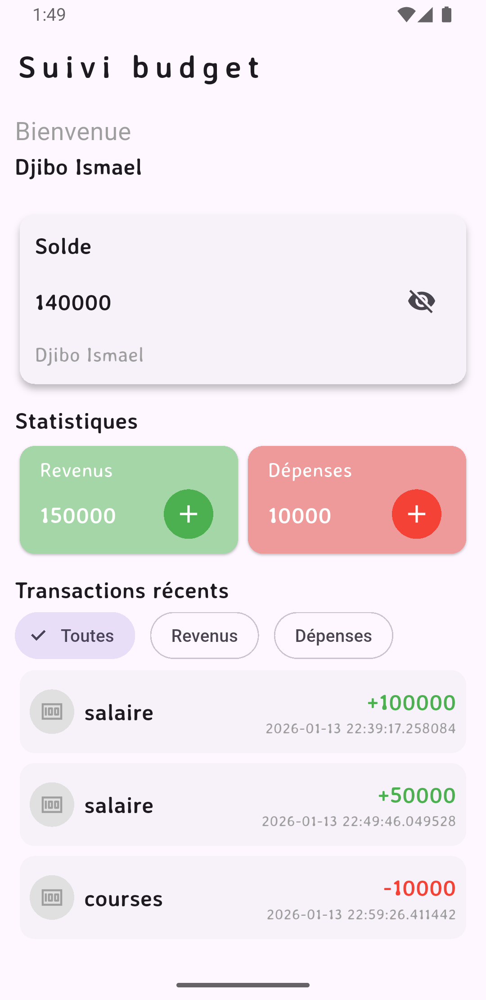
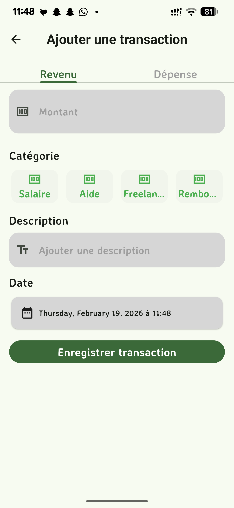
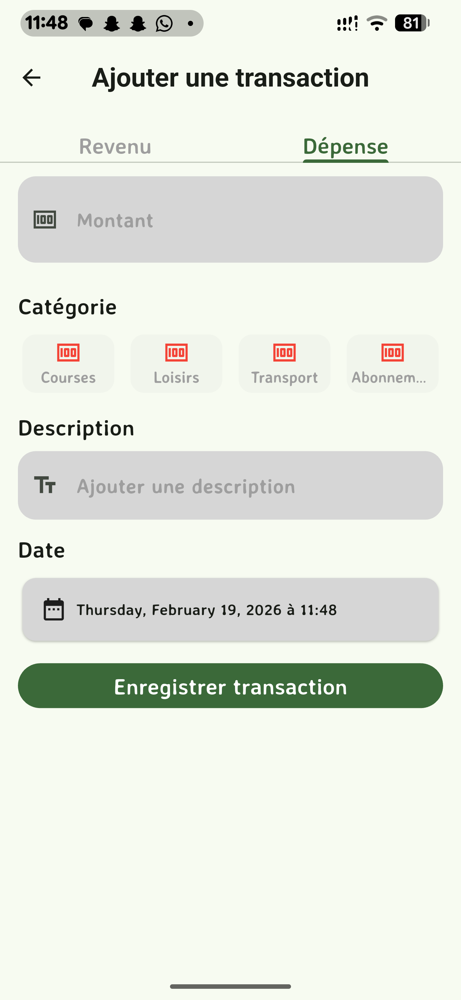
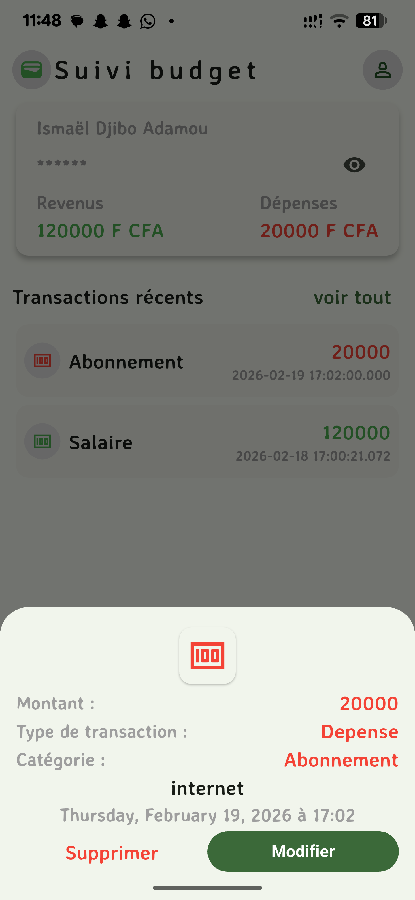
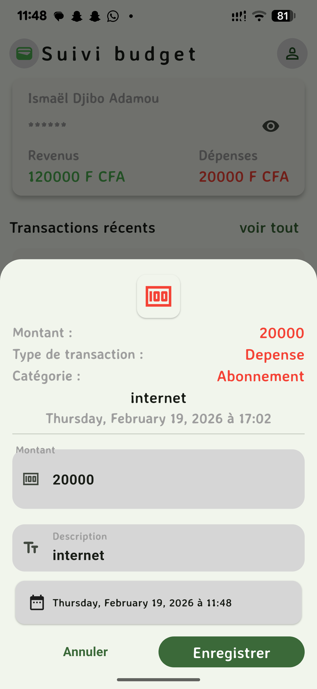

# Suivi Budget

**Application de gestion de finances personnelles en Flutter — et étude comparative de trois stratégies de persistance.**

Ce dépôt n'est pas seulement une application : c'est une exploration pratique de trois façons de stocker les données d'un même produit — stockage local offline-first, Firebase, Supabase — pour comparer confidentialité, coût de mise en œuvre, synchronisation et complexité.

> **Version la plus aboutie :** branche [`local-storage`](https://github.com/Idjibo33/suivi_budget/tree/local-storage) (100 % hors-ligne, Floor/SQLite, démo en ligne).

## Stratégies de persistance (branches)

| Branche | Stratégie | Contenu |
|---|---|---|
| [`local-storage`](https://github.com/Idjibo33/suivi_budget/tree/local-storage) | **Locale (Floor + sqflite)** | Version complète et active : CRUD, filtrage, solde, authentification locale, `PRIVACY.md` (préparation Play Store). Déployée sur la démo |
| [`backend-firebase`](https://github.com/Idjibo33/suivi_budget/tree/backend-firebase) | Cloud (Firebase Auth, hosting) | Version intermédiaire de l'étude |
| [`backend-supabase`](https://github.com/Idjibo33/suivi_budget/tree/backend-supabase) | Cloud (Supabase Auth, PostgreSQL) | Version intermédiaire de l'étude |

La branche `main` contient l'ossature UI et les interfaces de services (`DatabaseServices`, `AuthServices`) ; les implémentations de persistance vivent dans les branches ci-dessus.

## Fonctionnalités (version `local-storage`)

- **Transactions :** enregistrement, modification, suppression et lecture des revenus et dépenses, avec persistance immédiate.
- **Filtrage dynamique :** tri sur l'écran d'accueil pour isoler les flux financiers.
- **Calcul automatique :** mise à jour instantanée du solde global.
- **Authentification locale :** vérification à l'ouverture de l'application (`local_auth`).
- **Offline-first :** aucune donnée ne quitte l'appareil.

## Aperçu

[Live demo](https://suivi-budget-local.vercel.app/)

| Accueil | Revenu | Dépense | Détails | Modifier | Profil |
|---|---|---|---|---|---|
|  |  |  |  |  |  |

## Technologies

| Domaine | Technologie |
|---|---|
| Framework | Flutter / Dart |
| Gestion d'état | Provider |
| Persistance locale | Floor + sqflite |
| Authentification locale | `local_auth` |
| UI | `google_fonts`, `skeletonizer`, `top_snackbar_flutter`, `gap`, `intl` |

## Installation

```bash
flutter pub get
flutter run
```

Pour la version fonctionnelle complète :

```bash
git checkout local-storage
flutter pub get
flutter run
```

## Prochaines étapes

- Analyses graphiques : diagrammes par catégorie de transactions.
- Tests unitaires sur les calculs de solde et le filtrage.
- Synthèse comparative écrite des trois stratégies (coût, confidentialité, complexité).

## Licence

[MIT](LICENSE)
