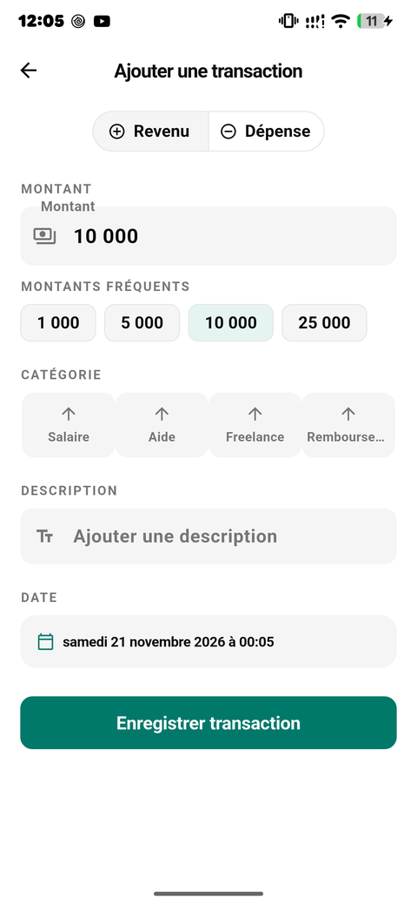
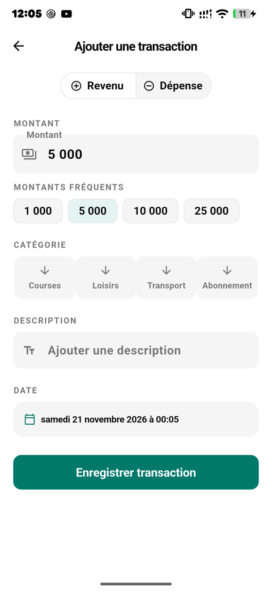
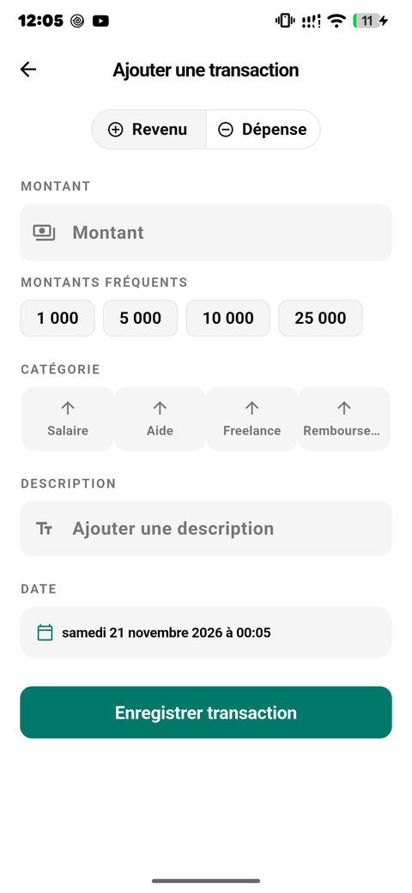
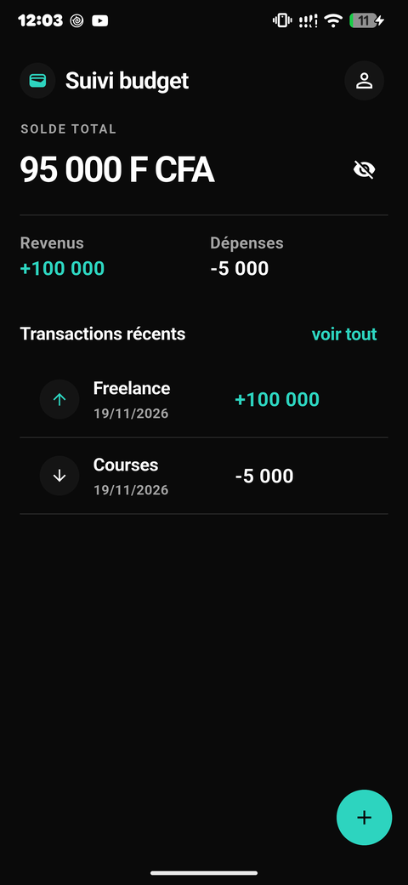
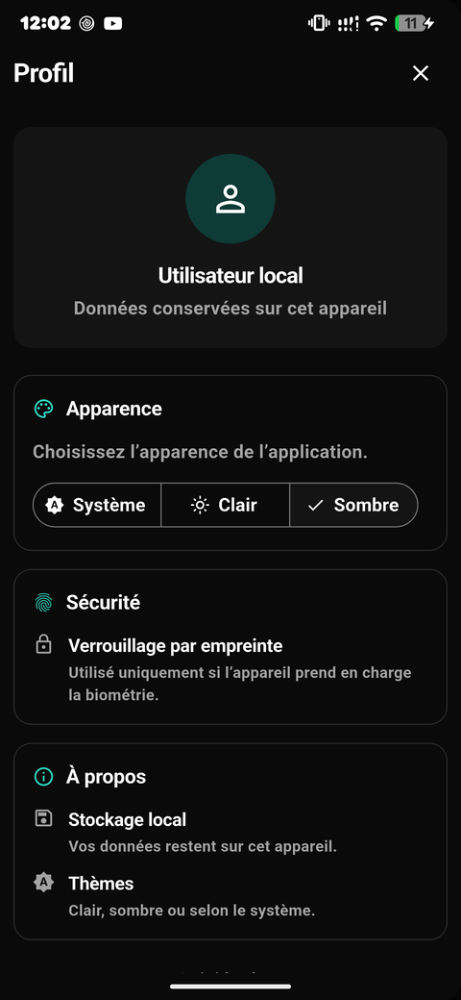

# MyBudget

**Branches :** `main` (production) · `develop` (développement). Une seule version de l'app : 100 % locale, sans backend.

MyBudget privilégie la confidentialité et la rapidité en stockant 100 % des données sur l'appareil de l'utilisateur. Aucun compte, aucun serveur, aucune donnée transmise.

- **Nom affiché :** `MyBudget` en production, `MyBudget Dev` en développement.
- **Identifiants :** `com.mybudget.app` (prod), `com.mybudget.app.dev` (dev).
- **Éditeur :** MyBudget (Ismaël) — djiboismaelzeno@gmail.com.
- **Moteur :** SQLite (Floor) + authentification locale (`local_auth`).

## Plateformes

| Plateforme | Production (`main`) | Développement (`develop`) |
| :--- | :--- | :--- |
| **Android** | AAB signé, prêt pour la Play Console | APK signé installable |
| **iOS** | Build simulateur non signé (`.app`) | Build simulateur non signé (`.app`) |
| **Web** | [idjibo33.github.io/suivi_budget/](https://idjibo33.github.io/suivi_budget/) | [idjibo33.github.io/suivi_budget/dev/](https://idjibo33.github.io/suivi_budget/dev/) |
| **Linux** | Archive `.tar.gz` | Archive `.tar.gz` |
| **Windows** | Archive `.zip` | Archive `.zip` |

> **Limite iOS :** les builds iOS sont produits pour simulateur, sans signature. Ils ne sont pas installables sur un appareil physique ni publiables sur l'App Store. Aucun IPA signé n'est généré.

> **Publication :** aucun déploiement automatique dans les stores. L'AAB de production doit être téléversé manuellement dans la Play Console (fiche store, track, notes de version et validation Google). Les artifacts sont téléchargeables depuis l'onglet **Actions** du dépôt (artifacts `mybudget-<flavor>-<plateforme>-<sha>`).

## Releases

Un push sur `main` ou `develop` déclenche le workflow GitHub Actions qui :

1. Vérifie le code (`flutter analyze --no-fatal-infos`, `flutter test`, build Web).
2. Construit les artifacts pour chaque plateforme avec le flavor déduit de la branche.
3. Déploie le Web sur GitHub Pages : racine pour `main`, `/dev/` pour `develop` (les fichiers existants sont conservés).

Le numéro de build est fourni par `github.run_number` ; la version applicative reste `1.0.0`.

## Fonctionnalités

### Authentification

- Vérification par empreinte à l'ouverture **uniquement si l'appareil prend réellement en charge la biométrie** (matériel présent et empreinte enregistrée). Sinon, l'accueil s'ouvre directement, sans dialogue bloquant.

### Gestion des transactions

- **Opérations CRUD :** enregistrement, modification, suppression et lecture des revenus et dépenses, avec persistance immédiate.
- **Calcul automatique :** mise à jour instantanée du solde global, des revenus et des dépenses.
- **Choix rapides :** des `ChoiceChip` proposent 1 000, 5 000, 10 000 et 25 000 pour remplir le champ montant.
- **Formatage centralisé :** regroupement français des milliers, signe `+`/`-` et suffixe `F CFA` via `FormatMontant`. Aucune couleur de statut : le signe et l'icône portent le sens du montant.

### Apparence

- **Thèmes clair et sombre**, avec réglage « Système », « Clair » ou « Sombre » depuis la page Profil.
- Palette volontairement limitée au noir, blanc et teal, avec des contrastes vérifiés au seuil AA.

### Interface adaptative

- **Téléphone (< 600 px) :** navigation d'origine, dessinée pour l'écran tactile.
- **Tablette (600–999 px) :** rail de navigation compact (icônes).
- **Desktop / grand écran (≥ 1000 px) :** rail étendu avec libellés, contenu centré et borné, dialogues et sélecteur de date adaptés.

## Technologies utilisées

- **Framework :** Flutter
- **Stockage :** Floor, Sqflite (FFI sur desktop)
- **Gestion d'état :** Provider
- **Authentification :** local_auth
- **CI/CD :** GitHub Actions, GitHub Pages

## Aperçu

Captures réalisées sur un Pixel 7 Pro avec les thèmes clair et sombre.

### Thème clair

| Accueil | Profil | Création — revenu | Création — dépense |
| :---: | :---: | :---: | :---: |
|  |  |  |  |

### Création et détail

| Formulaire vide | Détail d'une transaction | Modification |
| :---: | :---: | :---: |
|  |  |  |

### Thème sombre

| Accueil | Profil | Création |
| :---: | :---: | :---: |
|  |  |  |

## Prochaines étapes

- **Analyses graphiques :** ajout de diagrammes pour visualiser les catégories de transactions.
- **Export PDF :** génération de rapports.
