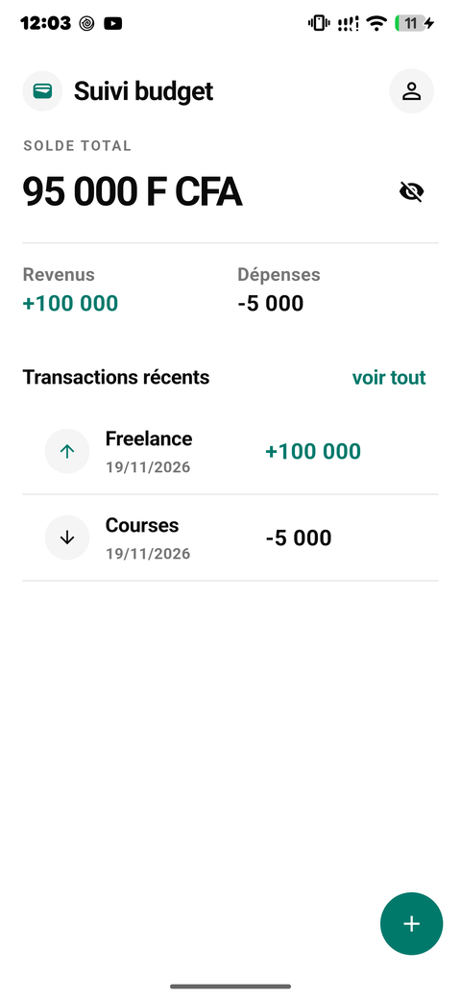
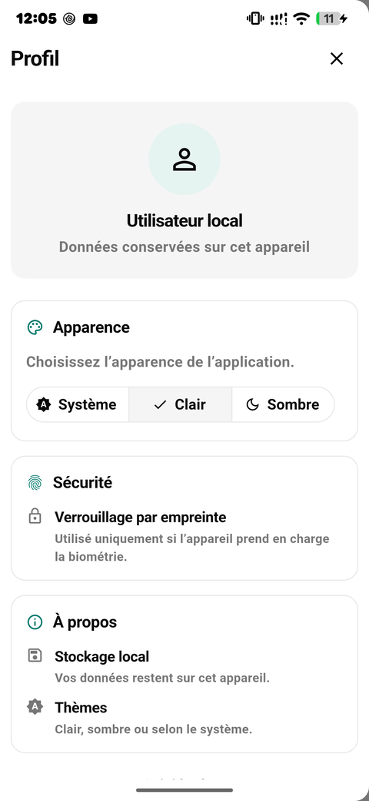
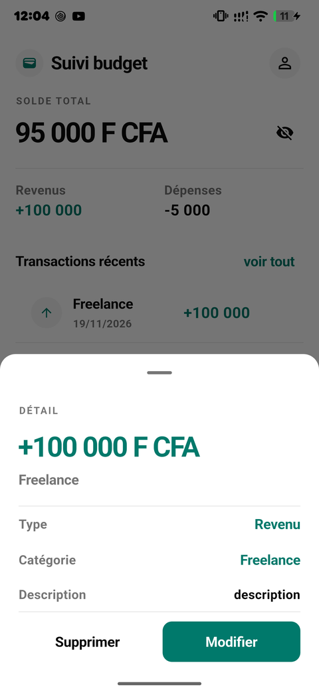
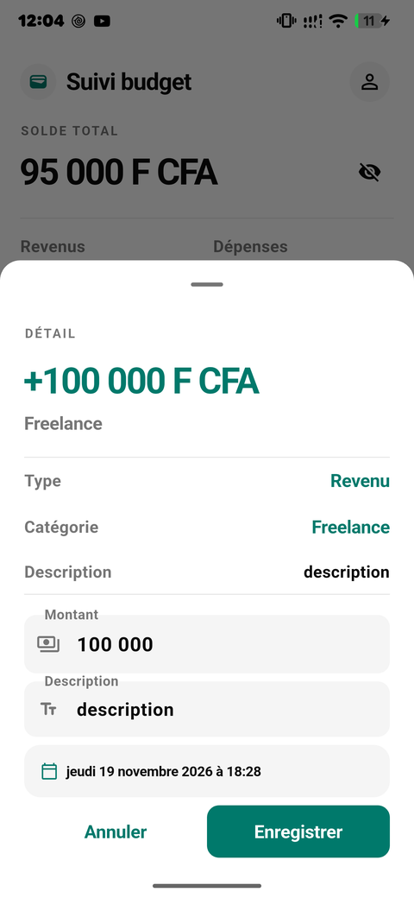
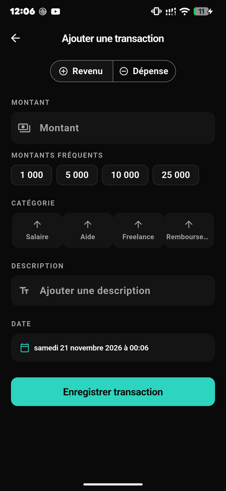

# suivi_budget

**Branches :** `main` (production) · `develop` (développement). Une seule version de l'app : 100 % locale, sans backend.

Cette version de l'application privilégie la confidentialité et la rapidité en stockant 100 % des données sur l'appareil de l'utilisateur.

- **Moteur :** SQLite (Floor) + authentification locale (`local_auth`).

## Fonctionnalités

### Authentification

- Vérification par empreinte à l'ouverture **uniquement si l'appareil prend réellement en charge la biométrie** (matériel présent et empreinte enregistrée). Sinon, l'accueil s'ouvre directement, sans dialogue bloquant.

### Gestion des transactions

- **Opérations CRUD :** enregistrement, modification, suppression et lecture des revenus et dépenses, avec persistance immédiate.
- **Calcul automatique :** mise à jour instantanée du solde global, des revenus et des dépenses.
- **Choix rapides :** des `ChoiceChip` proposent 1 000, 5 000, 10 000 et 25 000 pour remplir le champ montant.
- **Formatage centralisé :** regroupement français des milliers, signe `+`/`-` et suffixe `F CFA` via `FormatMontant`. Aucune couleur de statut : le signe et l'icône portent le sens du montant.

### Apparence

- **Thèmes clair et sombre**, avec réglage « Système », « Clair » ou « Sombre » depuis la page Profil.
- Palette volontairement limitée au noir, blanc et teal, avec des contrastes vérifiés au seuil AA.

## Technologies utilisées

- **Framework :** Flutter
- **Stockage :** Floor, Sqflite
- **Gestion d'état :** Provider
- **Authentification :** local_auth

## Aperçu

Captures réalisées sur un Pixel 7 Pro avec les thèmes clair et sombre.

### Thème clair

| Accueil | Profil | Création — revenu | Création — dépense |
| :---: | :---: | :---: | :---: |
|  |  |  |  |

### Création et détail

| Formulaire vide | Détail d'une transaction | Modification |
| :---: | :---: | :---: |
|  |  |  |

### Thème sombre

| Accueil | Profil | Création |
| :---: | :---: | :---: |
|  |  |  |

## Prochaines étapes

- **Analyses graphiques :** ajout de diagrammes pour visualiser les catégories de transactions.
- **Export PDF :** génération de rapports.
